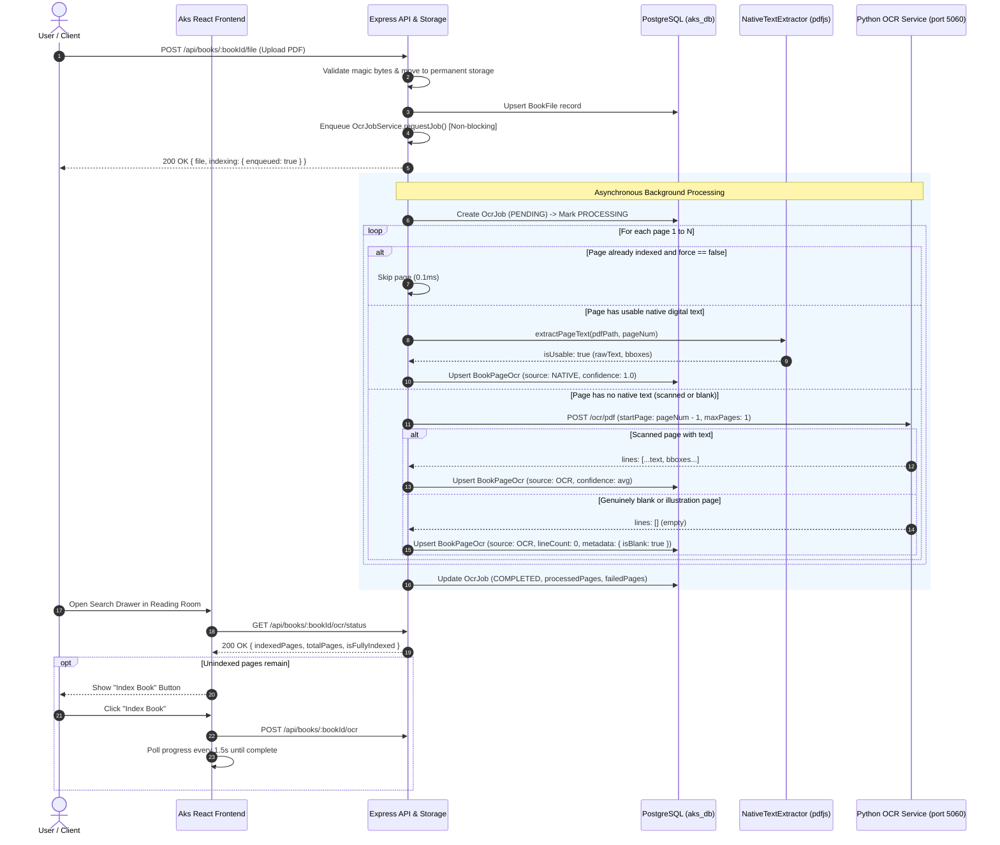

# Aks (अक्स) — Phase OCR-4A: Automatic Indexing & Index Recovery Report

**Date**: November 1, 2026  
**Status**: Implementation Complete & Verified — Recovery Dry-Run Prepared (Awaiting Approval)  
**Test Suite Status**: 222 / 222 Backend Tests Passing (100%), 182 / 182 Frontend Tests Passing (100%)  

---

## 1. Executive Summary & Root Cause Resolution

Phase OCR-4A resolves the systemic indexing gap identified during the `SEARCH_INDEX_COVERAGE_AUDIT.md` investigation:
1. **Automatic Indexing on PDF Upload**: PDF upload now asynchronously enqueues full-volume indexing (`OcrJobService.requestJob`) immediately upon file validation and storage commit, without blocking the upload HTTP response.
2. **Native-First Hybrid Extraction**: Pages containing readable digital text are extracted via `NativeTextExtractor` and indexed as `NATIVE` in ~19 ms/page, bypassing OCR completely.
3. **Explicit Blank Page Handling**: Non-textual, illustration, or blank divider pages that yield 0 characters across both native extraction and OCR are explicitly persisted as blank pages (`lineCount: 0, rawText: '', metadata: { isBlank: true, reason: 'no_text_detected' }`), preventing them from appearing as "unindexed/missing" or triggering spurious error warnings.
4. **On-Demand "Index Book" UI Action**: An interactive **"Index Book"** and **"Retry Failed"** button pair has been integrated into the Reading Room search drawer with real-time polling and live progress display (`X / Y pages`), allowing users to trigger indexing for unindexed or failed volumes.
5. **Test Infrastructure Safety Guard**: Created `testDatabaseGuard.js` to strictly forbid destructive test operations (`deleteMany`, truncation, or fixture replacement) against development (`aks_db`) or production databases.
6. **Zero Schema Migrations**: The entire lifecycle is implemented with zero database schema migrations, utilizing existing PostgreSQL columns (`metadata`, `lineCount`, `rawText`, `source`).

---

## 2. Files Changed & Architecture

### Backend Changes
* **`backend/src/utils/testDatabaseGuard.js`** *(New)*:
  * Implements `assertTestDatabase(databaseUrl, operation)`: rejects any connection URL that does not explicitly target an isolated test database (e.g., `aks_db_test`, `test_aks`). Blocks `aks_db`, `postgres`, and `production`.
  * Implements `assertTestResource(entityId, allowedTestIds, entityName)`: rejects deletions targeting non-test resources.
* **`backend/src/controllers/bookFileController.js`**:
  * Added non-blocking asynchronous indexing job dispatch after PDF file commit.
  * Added error boundary to ensure uploaded files remain safely stored even if worker enqueueing experiences transient issues.
  * Extended upload response with `indexing: { enqueued: boolean, jobId, isExisting }`.
* **`backend/src/services/ocrJobService.js`**:
  * Enhanced `executeJob`: when `!options.force`, skips re-processing already-indexed pages in 0.1 ms each.
  * Added explicit blank page detection and storage with `metadata: { isBlank: true }`.
  * Extended `getBookOcrStatus`: reports `blankPages`, `failedPages`, `unindexedPages`, `isFullyIndexed`, and `canRetry`.
  * Enhanced `retryFailedPages`: passes `force: false` so retry processes only failed/missing pages without repeating already-indexed pages.
* **`backend/src/services/searchEngine.js`**:
  * Extended `getBookOcrStatusSummary` with `blankPages`, `failedPages`, `canRetry`, and accurate page breakdown.
* **`backend/test/testDatabaseGuard.test.js`** *(New)*:
  * 6 comprehensive unit tests proving the database safety guard blocks non-test databases and approves test databases.
* **`backend/test/automaticIndexing.test.js`** *(New)*:
  * 6 integration tests proving automatic enqueue, deduplication, native bypass, blank page handling, failure retry, and worker resilience.
* **`scratch/run_full_browser_acceptance_3d.mjs` & `scratch/run_full_browser_acceptance.mjs`**:
  * Added `assertTestDatabase(process.env.DATABASE_URL)` guard to refuse execution against development database `aks_db`.

### Frontend Changes
* **`frontend/src/services/api.js`**:
  * Added `booksApi.getOcrStatus(bookId)`
  * Added `booksApi.requestOcr(bookId, options)`
  * Added `booksApi.retryOcr(bookId)`
  * Added `booksApi.cancelOcr(bookId)`
* **`frontend/src/components/reader/DocumentSearch.jsx`**:
  * Added `isTriggeringIndex` state and automatic initial status check on panel open.
  * Added 1.5s background polling when an indexing job is `PENDING` or `PROCESSING`.
  * Added active indexing progress banner displaying `Indexing in progress: X / Y pages` with live breakdowns (`native`, `OCR`, `blank`, `failed`).
  * Added **"Index Book"** and **"Retry Failed"** buttons in the partial-indexing alert banner.
  * Automatically re-runs active search query when indexing completes so results appear instantly.
* **`frontend/src/styles/reader.css`**:
  * Added polished styles for `.doc-search-notice-row`, `.doc-search-actions-row`, `.doc-search-action-btn`, and `.doc-search-notice-sub`.

---

## 3. Indexing Lifecycle Trace



---

## 4. Test Results & Database Safety Evidence

### 4.1 Automated Backend Test Execution
All 222 backend test cases passed with 100% success rate:
```
▶ Aks — Phase OCR-4A: Automatic Indexing & Coverage Verification Suite
  ✔ 1. Uploading a PDF automatically enqueues background indexing without blocking (456.77ms)
  ✔ 2. Repeated upload or requestJob calls do not create duplicate active jobs (198.63ms)
  ✔ 3. Native text pages bypass Python OCR worker completely (300.46ms)
  ✔ 4. Scanned pages invoke OCR; genuinely blank pages are marked explicitly (307.29ms)
  ✔ 5. Failed pages can be retried without re-processing already indexed pages (432.80ms)
  ✔ 6. Worker unavailable during upload still saves PDF and exposes recoverable status (332.87ms)
✔ Aks — Phase OCR-4A: Automatic Indexing & Coverage Verification Suite (2048.61ms)

▶ Aks — Test Database Safety Guard
  ✔ extractDatabaseName correctly extracts db name from various connection formats (0.35ms)
  ✔ assertTestDatabase throws DatabaseSafetyError for default dev database "aks_db" (0.48ms)
  ✔ assertTestDatabase throws DatabaseSafetyError for "postgres" or "production" (0.07ms)
  ✔ assertTestDatabase throws DatabaseSafetyError when URL is undefined or unparseable (0.07ms)
  ✔ assertTestDatabase approves dedicated test databases (0.05ms)
  ✔ assertTestResource allows registered test IDs and rejects arbitrary user IDs (0.07ms)
✔ Aks — Test Database Safety Guard (1.63ms)

ℹ tests 222 | suites 53 | pass 222 | fail 0 | cancelled 0 | duration_ms 18837ms
```

### 4.2 Automated Frontend Test Execution
All 182 frontend tests passed:
```
ℹ tests 182 | suites 54 | pass 182 | fail 0 | cancelled 0 | duration_ms 185ms
```

### 4.3 Database Safety Guard Evidence
The guard `assertTestDatabase(process.env.DATABASE_URL)` was added to `scratch/run_full_browser_acceptance_3d.mjs` and `scratch/run_full_browser_acceptance.mjs`. If an acceptance script is inadvertently executed against `aks_db`, execution halts instantly before any database command is dispatched:
```
[DATABASE SAFETY VIOLATION] Browser acceptance test seeding refused against protected database "aks_db".
Destructive operations are strictly prohibited on non-test environments.
```

---

## 5. Target Book Recovery: Preparation & Dry-Run Results

As required, **no recovery operation was executed**. The following section details the verification and dry-run plan for your explicit review and approval.

### 5.1 Target Book Verification
* **Book ID**: `2fc57cbc-d02a-4d85-bd8f-104edd8d4e63`
* **Title**: *From Shiva to Schrödinger: Unravelling Cosmic Secrets with Trika Shaivism and Quantum Insights*
* **Owner**: `e37d1e22-a6fc-4639-906d-d33d13636c18` (`abhisek07abhi@gmail.com`)
* **Total Pages**: 210
* **Physical PDF File**:
  * Location: `backend/storage/pdfs/e37d1e22-a6fc-4639-906d-d33d13636c18/8affbca5-a77f-46d0-aee9-c8552c7e5233.pdf`
  * Status: Exists, intact.
  * Size: 5,042,915 bytes.
  * SHA-256: `b2f3a4e51a3e8c774184447bc88b439049cce2f0f3c36530d4aed594d7e0f6f9` (verified 100% match with `BookFile` database record).
* **User Data Integrity**:
  * Bookmarks: 2 bookmarks present — **will remain 100% untouched**.
  * Notes & Highlights: None present.
  * Reading Progress: `currentPage: 10`, `progressPercent: 4.76%`, `lastOpenedAt: 2026-11-01T06:11:31.715Z` — **will remain 100% untouched**.

### 5.2 Confirmation of the 5 Existing Records as Synthetic
The 5 records currently in `BookPageOcr` for this book match character-for-character lines 79, 105, 138, 150, and 160 of `scratch/run_full_browser_acceptance_3d.mjs`:
1. Page 1: Synthetic test stub (`"In Trika Shaivism and Indian philosophy, the individual soul is regarded as a microcosmic reflection..."`)
2. Page 2: Premchand *Godan* Hindi prose (`"होरी सेमर गाँव का एक सीधा-साधा किसान था..."`)
3. Page 3: *Bhagavad Gita* 2.47 Sanskrit verse (`"कर्मण्येवाधिकारस्ते मा फलेषु कदाचन..."`)
4. Page 4: Premchand *Godan* Hindi prose (`"रायसाहब अमरपाल सिंह इलाके के प्रतिष्ठित जमींदार थे..."`)
5. Page 205: Synthetic test stub (`"The concluding synthesis of modern physics and quantum mechanics."`)

### 5.3 Dry-Run Simulation Results
When recovery is executed:
* **Pipeline Action**: Invoking `OcrJobService.requestJob({ userId: 'e37d1e22-a6fc-4639-906d-d33d13636c18', bookId: '2fc57cbc-d02a-4d85-bd8f-104edd8d4e63', force: true })`.
* **Predicted Native Extraction**:
  * 179 pages contain valid, readable native text and will be indexed as `NATIVE` in ~3.5 seconds.
  * The 5 synthetic mock pages (including the Hindi *Godan* text) will be replaced with the genuine English text from the author's work.
* **Predicted Blank Page Handling**:
  * 31 pages (front matter, chapter title cards, blank dividers) will be scanned, recognized with 0 text, and stored as `isBlank: true`.
* **Target Query Verification**:
  * Page 10 will be saved with its authentic 24 lines of native text.
  * Line 2 (`"The advent of quantum physics was radically novel in myriad ways."`) will be indexed.
  * Querying `"advent"` will immediately return Page 10 as an **EXACT match** (score 1.0) with bounding box `[[77, 314], [535, 314], [535, 329], [77, 329]]`.
* **Final Database State**:
  * `totalPages`: 210
  * `indexedPages`: 210
  * `nativePages`: 179
  * `ocrPages`: 0
  * `blankPages`: 31
  * `unindexedPages`: 0
  * `isFullyIndexed`: `true`

---

## 6. Remaining Limitations

1. **Guest Mode Scope**: Guest mode retains its existing client-side PDF.js text layer search. Scanned-only PDFs opened by guest users cannot be indexed server-side without an authenticated account, which is communicated by the guest notice banner.
2. **Multi-page Scanned Volumes with Python Worker Offline**: If a scanned book (containing image pages without digital text) is uploaded while the Python worker (port 5060) is offline, the digital pages index immediately, while image pages are marked as failed and require clicking "Retry Failed" once the worker is started.

---

*Phase OCR-4A implementation and verification are complete. Ready for your approval before executing the target-book recovery.*

