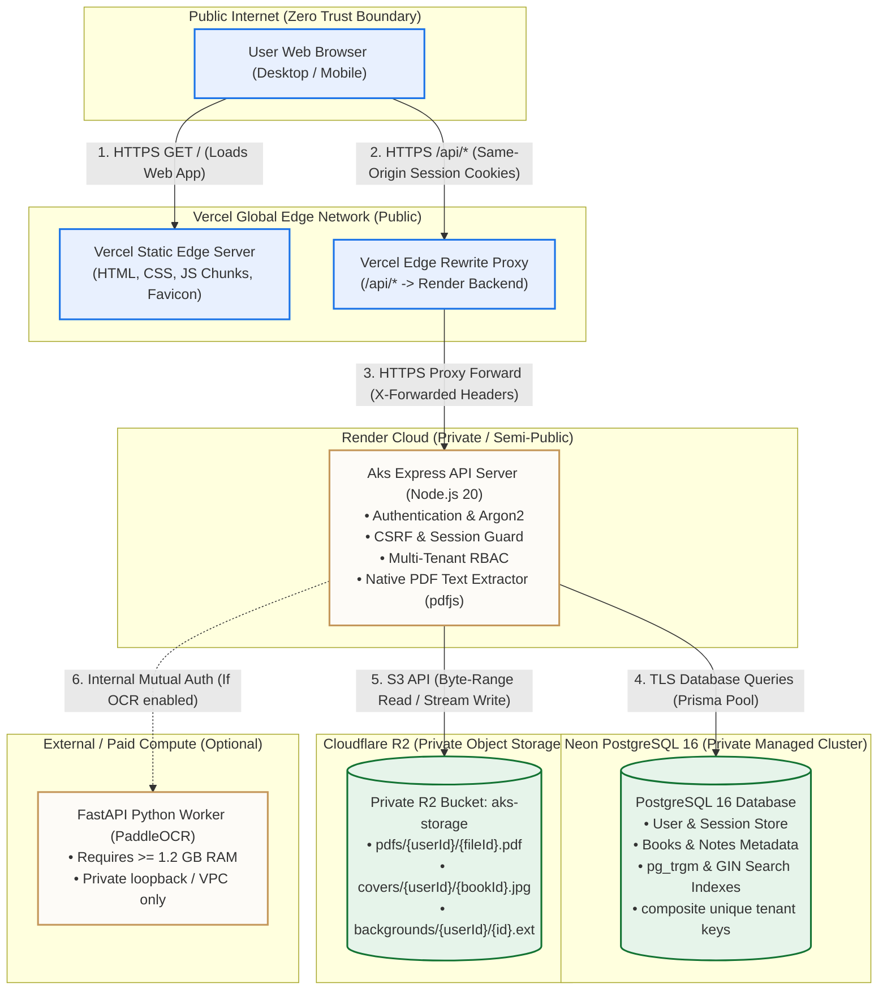

# Aks (अक्स) — Public Cloud Deployment Architecture

**Document Version:** 1.0.0  
**Target Architecture:** Vercel (Frontend) + Render (Backend) + Neon (Database) + Cloudflare R2 (Object Storage)

---

## 1. Architectural Overview

The proposed production architecture separates compute, static assets, database records, and binary storage into dedicated, horizontally scalable cloud tiers:

1. **Frontend (Vercel):** Serves the pre-compiled React 19 SPA through a global edge CDN with HTTP/3 and automated TLS. Acts as a same-origin reverse proxy for `/api/*` requests to eliminate cross-site cookie restrictions.
2. **Backend API (Render):** Express 4 REST API handling authentication, authorization, session management, CSRF validation, and search queries.
3. **Database (Neon):** Serverless PostgreSQL 16 cluster storing structured relational entities, GIN trigram indexes for multilingual search, and encrypted user credentials.
4. **Object Storage (Cloudflare R2):** S3-compatible private bucket storing user PDFs, extracted cover thumbnails, and atmosphere assets with zero egress bandwidth charges.
5. **OCR Engine (Conditional / Tiered):** Native PDF text extraction runs within the Node.js backend. Scanned OCR processing is either hosted on a dedicated >= 1GB compute node or disabled on pure free tiers.

---

## 2. System Architecture Diagram

---

## 3. Public vs. Private Boundary Isolation

| Service / Resource | Accessibility | Network Exposure | Security Controls |
|---|---|---|---|
| **Vercel Frontend** | **Public** | Accessible via `https://your-domain.vercel.app` or custom domain | Global CDN, TLS 1.3, DDoS mitigation |
| **Vercel `/api/*` Proxy** | **Public** | Routes `/api/*` to Render | Enforces CORS, strips dangerous headers |
| **Render Backend API** | **Semi-Public** | Target of Vercel proxy | Helmet security headers, rate limiting, CSRF tokens, Session validation |
| **Neon PostgreSQL** | **Private** | Reachable only via TLS connection string (`sslmode=require`) | Encrypted at rest, password protected, IP whitelist (optional) |
| **Cloudflare R2 Bucket** | **Strictly Private** | Zero public web access | AWS S3 Signature v4 authentication, bucket credentials stored in backend env only |
| **Python OCR Engine** | **Strictly Private** | Internal network or token-authenticated VPC | Bearer token authentication ([ocr-engine/src/api.py](file:///Users/cs/Documents/Library/ocr-engine/src/api.py#L33-L47)), zero direct browser access |

---

## 4. Critical Data & Request Flows

### 4.1 Authentication & Session Flow
1. Browser loads `https://your-domain.vercel.app`.
2. Browser issues `GET /api/auth/csrf` to the same origin (`your-domain.vercel.app`).
3. Vercel edge proxy forwards the request to `https://aks-backend.onrender.com/api/auth/csrf`.
4. Render backend initializes an unauthenticated session in Neon PostgreSQL and returns `Set-Cookie: aks.sid=...; Path=/; HttpOnly; SameSite=Lax; Secure`.
5. Because the browser initiated the request to `your-domain.vercel.app`, the cookie is stored as a **First-Party Cookie**.
6. Subsequent login requests (`POST /api/auth/login`) include the session cookie and `X-CSRF-Token` header automatically.

### 4.2 PDF Upload Flow
1. User selects a PDF file in the Reading Room.
2. Browser sends multipart payload to `/api/books/:bookId/file`.
3. Busboy streams chunks to backend memory or ephemeral disk.
4. Magic bytes (`%PDF-`) and file structure are validated.
5. Stream is piped directly to Cloudflare R2 bucket at key `pdfs/{userId}/{fileId}.pdf`.
6. BookFile record in Neon is updated with `storagePath: "pdfs/{userId}/{fileId}.pdf"`.
7. Native PDF text extractor runs asynchronously on the stream/file to populate search tokens in Neon.

### 4.3 PDF Streaming & Range Request Flow
1. PDF.js in browser requests byte range `Range: bytes=0-65535` from `/api/books/:bookId/file`.
2. Render backend checks session authentication and verifies book ownership (`userId == req.userId`).
3. Backend issues an S3 `GetObjectCommand` to Cloudflare R2 with `Range: bytes=0-65535`.
4. R2 streams only the requested 64 KB slice back to the backend.
5. Backend responds to PDF.js with `HTTP 206 Partial Content`, `Content-Range: bytes 0-65535/totalSize`, and pipes the byte stream.
6. Zero local disk storage is consumed on the Render container.

